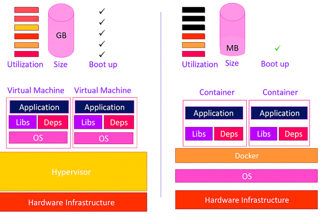

# SP 4 - Mission 1 - Formation - Docker

<div style="margin-top: 20px; border: 1px solid #ccc; padding: 20px; border-radius: 10px; background-color: var(--md-default-bg-color);">
    <p><strong>Auteur :</strong> KADA Amine</p>
    <p><strong>Classe :</strong> BTS SIO 2 - Option SISR</p>
    <p><strong>Date :</strong> 10/10/2026</p>
    <p><strong>Version :</strong> 1.0</p>
</div>


**SP 4 : Mise en place d’un espace de développement**

**Mission 1 : Mise en place d’un environnement de test conteneurisé dans une DMZ interne avec Docker et préparation d’une formation développeurs.**


-----

## Informations générales

  - **Date de création** : 09/04/2026
  - **Dernière modification** : 10/04/2026
  - **Mainteneur** : KADA Amine
  - **Public cible** : Développeurs (Étudiants SLAM)

-----

## Sommaire

  - 1. L'enfer du développeur (Pourquoi Docker ?)
  - 2. La révolution Docker
  - 3. L'anatomie de Docker (Les Fondations)
  - 4. L'ère des Micro-services et l'Orchestration
  - 5. Illustration d'utilisation
  - 6. Standards de l'Industrie (Bonnes pratiques)

-----

## 1. L'enfer du développeur (Pourquoi Docker ?)

Tout développeur a déjà prononcé cette phrase : **"Pourtant, ça marche sur ma machine !"**.

Historiquement, le développement web souffre d'un problème majeur : la **différence d'environnement**. Un code écrit sur un ordinateur Windows avec PHP 8.1 et MariaDB 10.4 peut s'effondrer sur un serveur Linux en production utilisant PHP 8.2.

Voici les conséquences directes sans isolation :

  * **Conflits de versions :** Impossible de faire tourner deux projets nécessitant des versions différentes de la même base de données.
  * **L'enfer des dépendances :** Installer des dizaines d'outils sur votre machine locale pollue votre système.
  * **Risques pour Millenuits :** Déployer une application en production sans certitude de son comportement peut entraîner des pannes critiques.

Enfin, sans outil adapté, **tester rapidement une nouvelle version** d'un langage (ex: passer de PHP 8.1 à 8.3) exige de désinstaller et réinstaller l'outil sur votre ordinateur. C'est long et risqué.

## 2. La révolution Docker

Créé en **2013** par le français **Solomon Hykes**, **Docker** a standardisé la notion de **conteneurisation**.

Docker emballe votre application et toutes ses dépendances (bibliothèques, outils, versions exactes) dans une boîte standardisée. Ce fonctionnement garantit que **si l'application fonctionne sur le poste du développeur, elle fonctionnera de manière identique en production**. Il résout instantanément les problèmes de dépendances locales et de compatibilité.

## 3. L'anatomie de Docker (Les Fondations)

### Les concepts clés

Pour comprendre Docker, utilisons des analogies simples :

  * **L'Image (Le Moule / La Recette) :** C'est un fichier inerte en lecture seule. Il contient le code source, les bibliothèques et les outils nécessaires. Imaginez une recette de cuisine précise ou le moule d'une pièce.
  * **Le Conteneur (Le Gâteau / L'Instance) :** C'est la version "vivante" de l'image. Docker prend le moule (l'image) et crée la pièce finale (le conteneur). Un conteneur est une entité en cours d'exécution. Il est **jetable** et **sans état** (éphémère). Si on le supprime, tout ce qu'il contient disparaît.
  * **Les Volumes (Le Disque Dur Externe) :** Puisqu'un conteneur est jetable, nous avons besoin d'un moyen pour sauvegarder les données (comme une base de données). Le **volume** est un espace de stockage indépendant du conteneur. Si le conteneur explose, les données dans le volume restent intactes.

### Machine Virtuelle (VM) vs Conteneur

  

  *Schéma - Conteneur VS machine virtuelle - KodeKloud*

  * **Machine Virtuelle (VM) :** Émule un ordinateur entier. Elle inclut son propre système d'exploitation (OS). C'est lourd (plusieurs Go) et lent à démarrer, mais **très bien isolé**.
  * **Conteneur Docker :** Partage le noyau du système d'exploitation de la machine hôte. C'est ultra-léger (quelques Mo), démarre en quelques secondes, mais l'isolation est **moins forte** qu'une VM.

### Parenthèse sur la sécurité : l'utilisateur Root

Dans le monde Linux, l'utilisateur **root** est le super-administrateur qui a tous les droits sur la machine.
**Par défaut, les processus dans un conteneur Docker tournent en tant que root.** 

* **Le danger :** Si un attaquant trouve une faille dans votre application, il prend le contrôle du conteneur. Comme il est root dans le conteneur, il pourrait (via certaines vulnérabilités) s'échapper du conteneur et devenir root sur le serveur hôte (la machine physique).

* **Bonne pratique :** Il faut configurer vos images Docker pour utiliser un utilisateur standard (non-root) afin de limiter les dégâts en cas de piratage.

## 4. L'ère des Micro-services et l'Orchestration

### Les limites du conteneur unique

Placer le serveur web, la base de données et l'application dans un seul conteneur est une mauvaise pratique. Si un élément plante, tout s'arrête. De plus, cela rend les mises à jour impossibles à isoler.

### Les Micro-services

La philosophie Docker impose une règle : **Un conteneur = Un service**. On sépare la base de données (MariaDB) dans un conteneur et le serveur web (Apache/PHP) dans un autre. C'est l'architecture en micro-services.

### Orchestration avec Docker Compose

Pour faire discuter ces conteneurs entre eux, nous utilisons un chef d'orchestre : **Docker Compose**. Il permet de démarrer, lier et configurer plusieurs conteneurs simultanément avec une seule commande, grâce à un fichier de configuration.

### L'Infrastructure as Code (IaC)

L'IaC consiste à écrire l'infrastructure matérielle (serveurs, réseaux) sous forme de lignes de code. Le fichier Docker Compose est de l'IaC. L'infrastructure devient lisible, reproductible et documentée automatiquement.

### GitOps et Versionning

Puisque notre infrastructure est désormais du code, nous pouvons la stocker sur **Git** (avec notre code PHP). Le **GitOps** est la pratique qui utilise Git comme source unique de vérité. Toute l'équipe possède la même infrastructure en téléchargeant simplement le dépôt.

## 5. Illustration d'utilisation

Déployons l'application de comptes rendus pour Millenuits. Nous avons besoin de PHP, Apache et MariaDB.

### Étape 1 : Créer l'image sur-mesure (Dockerfile)

Le fichier `Dockerfile` sert à créer notre propre image personnalisée pour le serveur Web.

```dockerfile
# Utilisation de l'image officielle PHP avec Apache
FROM php:8.2-apache

# Exécution d'une commande pour installer l'extension mysqli (nécessaire pour MariaDB)
RUN docker-php-ext-install mysqli

# Copie du code source local vers le dossier web du conteneur
COPY ./src /var/www/html/

# Indique que le conteneur écoute sur le port 80
EXPOSE 80
```

**Explication des commandes du Dockerfile :**

  * `FROM` : Définit l'image de base. Ici, on télécharge un environnement Linux contenant déjà PHP 8.2 et le serveur web Apache. *Pour tester PHP 8.3, il suffirait de changer `8.2-apache` en `8.3-apache`, sans rien installer sur votre PC.*
  * `RUN` : Exécute une commande Linux pendant la construction de l'image. Ici, on installe le pilote de base de données.
  * `COPY` : Transfère les fichiers de votre ordinateur (`./src`) vers l'intérieur du conteneur (`/var/www/html/` est le dossier public d'Apache).
  * `EXPOSE` : Documente le port réseau qui sera utilisé (80 est le port standard pour le trafic web HTTP).

### Étape 2 : L'Orchestration (docker-compose.yml)

Le fichier `docker-compose.yml` va démarrer la base de données et le serveur web créé précédemment.

```yaml
version: '3.8'

services:
  # Service 1 : Le serveur Web
  web:
    build: . 
    ports:
      - "8080:80"
    depends_on:
      - db

  # Service 2 : La base de données
  db:
    image: mariadb:10.11
    environment:
      MYSQL_ROOT_PASSWORD: <MOT_DE_PASSE_ROOT_MYSQL>
      MYSQL_DATABASE: millenuits_bdd
      MYSQL_USER: dev_user
      MYSQL_PASSWORD: <MOT_DE_PASSE_DEV>
    volumes:
      - db_data:/var/lib/mysql

# Déclaration des volumes persistants
volumes:
  db_data:
```

**Explication du code YAML et des notions :**

  * `version` : La version de la syntaxe Docker Compose utilisée.
  * `services` : Déclare les différents conteneurs (micro-services) de notre application.
  * `web` et `db` : Noms de nos services. Ils serviront également de nom d'hôte (DNS) sur le réseau interne Docker (le conteneur `web` peut pinger le conteneur `db`).
  * `build: .` : Indique à Docker Compose de lire le `Dockerfile` situé dans le dossier courant (`.`) pour fabriquer l'image du service web.
  * `ports` : Fait la liaison réseau. `"8080:80"` signifie : "Redirige le trafic du port 8080 de l'ordinateur physique vers le port 80 du conteneur".
  * `depends_on` : Force le service `web` à attendre le démarrage du service `db` avant de se lancer.
  * `image: mariadb:10.11` : Utilise une image officielle toute prête de MariaDB, version 10.11.
  * `environment` : Injecte des variables d'environnement dans le conteneur (ici, les identifiants de la base de données).
  * `volumes` : Connecte un volume nommé `db_data` au dossier interne du conteneur où MariaDB stocke ses données (`/var/lib/mysql`). Cela garantit que la base de données survit à l'arrêt du conteneur.

## 6. Standards de l'Industrie (Bonnes pratiques)

En tant que futur Développeur, vous devez appliquer ces règles afin de respecter l'état de l'art :

1.  **Ne jamais tourner en Root :** Utilisez l'instruction `USER` dans votre Dockerfile pour exécuter l'application avec un compte aux droits limités.
2.  **Optimisation du poids des images :** Utilisez des images de base légères (comme les versions `alpine`) et nettoyez les caches d'installation dans vos commandes `RUN`. Une image plus petite se déploie plus vite et contient moins de failles potentielles.
3.  **Gestion des secrets :** Ne codez **jamais** de mots de passe en dur dans le `docker-compose.yml` ou le code source. Utilisez des variables d'environnement externes (fichiers `.env` ignorés par Git) ou des coffres-forts numériques (comme HashiCorp Vault).
4.  **Organisation des dossiers :** Séparez le code applicatif (`/src`), les fichiers de configuration (`/config`) et les scripts de déploiement pour garder un projet lisible. Un fichier `docker-compose.yml` doit toujours se trouver à la racine du projet.